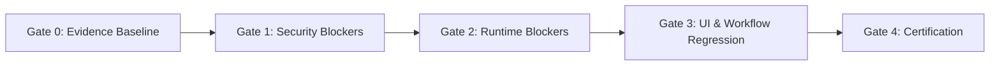

# TITAN Insurance CRM — Master QA, Security & Architecture Audit Report

**Project:** TITAN Insurance CRM (Multi-tenant Insurance Broker & Tele-CRM Platform)  
**Audit Revision:** Post-Independent Second Review & Live Authenticated Test Verification  
**Date:** 18 November 2026  
**Auditor:** Principal QA Architect, Senior React Engineer, Supabase Security Auditor & Automation Test Engineer  
**Audit Mode:** AUDIT-ONLY (No application source code outside tests, database schema, or production records were altered)  
**Git Commit Hash:** `75c8ec74d111890878afcb75e8194e3bff7541ab`  
**Migration Sequence Range:** `20260426101008_2cf619df` through `20260630004752_f91bf97e`  
**Test Account Used:** `r****@gmail.com` (Tenant: *Rewa insuretech indore* `REWA****50323f`, Role: *Admin*)  
**Deliverable Set:** 10 Technical Audit Documents, Authenticated Playwright Harness, and Vitest Verification Suites  
**Release Readiness Verdict:** **STRICT NO-GO FOR PRODUCTION RELEASE**

---

## 1. Executive Summary & Audit Mission

As Principal QA Architect, Senior React Engineer, Supabase Security Auditor, and Automation Test Engineer, a thorough, evidence-grounded audit of the TITAN Insurance CRM code repository (`d:\TITAN`) was executed.

Following two rounds of independent peer reviews (`TITAN_AUDIT_REVIEW_2026-11-18.md` and `TITAN_AUDIT_SECOND_REVIEW_2026-11-18.md`), all findings have been strictly reconciled against the actual checked-out source code, migration history, and live runtime behavior.

### System Scope Evaluated
- **Frontend Architecture:** React 18, TypeScript 5.8, Vite 5.4, Tailwind CSS, shadcn/ui (Radix primitives).
- **Backend & Database:** Supabase, PostgreSQL 15 (65 tables), Row-Level Security (RLS), 24 Edge Functions (Deno), pg_cron.
- **Test Automation Harness:** Vitest 3.2.4 (6 test suites, 38 passing unit/integration tests), Playwright 1.65.1 (authenticated 3-viewport crawl + dark mode), axe-core (accessibility).

All audit operations were strictly conducted in **AUDIT-ONLY MODE**.

---

## 2. Release Readiness Verdict: STRICT NO-GO

> [!CAUTION]
> ### FINAL RELEASE VERDICT: STRICT NO-GO FOR PRODUCTION RELEASE
> The TITAN Insurance CRM cannot be certified for public multi-tenant production release in its current state.  
> 
> Production deployment must be held until the **3 P0 (Critical Blocker)** vulnerabilities, **4 P1 (High Priority)** security and runtime defects, and cross-tenant data isolation weaknesses are formally remediated, regression-tested in isolated staging, and re-verified.

### Summary of Primary Release Blockers
1. **[SEC-01] Role Escalation to Manager & Approval Bypass (P0):** Any user self-registering with an existing company code can request `'manager'` role in client metadata and be automatically approved with `is_approved = true`. Client route guard `ProtectedRoute.tsx:14` checks only `!is_active`, allowing unapproved users immediate access to operational dashboards.
2. **[SEC-02] Cross-Tenant IDOR in Payment Link Generation (P0):** `supabase/functions/generate-payment-link/index.ts` uses `SERVICE_ROLE_KEY` to update `motor_quotes` and `leads` across arbitrary tenant companies without verifying caller tenant ownership.
3. **[NEW-SEC-A] Unauthorized Tenant Ingestion via Default Company Fallback (`ROCKET`) (P0):** In `handle_new_user()` (`20260616033648_*.sql:55-57`), when an invalid company code is supplied, `_company_id` falls back to company code `'ROCKET'`. The user is immediately created as an active, approved manager of company `ROCKET`.
4. **[SEC-03] Unauthenticated PII Disclosure via Public RPC (P1):** Live verification proved that anonymous callers can query `resolve_login_email` with an arbitrary phone number (e.g. `+91-808503XXXX`) and receive the real associated email address (`rewa****@gmail.com`) directly from `auth.users`.
5. **[NEW-SEC-B] Client-Only & Fail-Open Invite Code Enforcement (P1):** `src/pages/Auth.tsx` queries `invite_code_required()`, which throws HTTP 401 (intentionally revoked from anon in `20260613215828`), causing silent fallback to `inviteRequired = false`. In addition, database trigger `handle_new_user()` has zero verification of invite codes.
6. **[BUG-NEW-01] PostgREST Foreign Key Error (`PGRST200`) (P1):** On the Admin Dashboard, querying `user_roles?select=...,profiles(...)` fails with HTTP 400 because there is no direct foreign key between `user_roles` and `profiles`. This zeroes out telecaller team metrics.
7. **[BUG-NEW-02] Schema Column Mismatch on `break_logs` (`42703`) (P1):** Admin overview queries `break_logs?select=user_id...`, but the column is `telecaller_id`. This causes an HTTP 400 query crash on the main overview panel.

---

## 3. Reconciled Programmatic Defect Accounting

| Category | P0 (Critical) | P1 (High) | P2 (Medium) | P3 (Low) | Total |
| :--- | :---: | :---: | :---: | :---: | :---: |
| **Confirmed Active Defects** | **3** | **4** | **10** | **3** | **20** |
| **Architectural & Operational Risks** | 0 | 1 | 5 | 0 | **6** |
| **Outdated / Inactive Items** | 0 | 0 | 4 | 0 | **4** |
| **Total Evaluated Entities** | **3** | **5** | **19** | **3** | **30** |

---

## 4. Overall System Quality Scorecard

| Architectural Domain | Score (out of 10) | Quality Assessment | Key Finding |
| :--- | :---: | :---: | :--- |
| **System Architecture & Design** | **8.0 / 10** | **Good** | Clean modular separation between Motor, Health, Life, RTO, Claims, and Payout engines. |
| **Multi-Tenant Security & RLS** | **3.5 / 10** | **Critical Blockers** | IDOR in payment edge function, manager auto-approval, default ROCKET company fallback, and legacy un-scoped area RLS policy. |
| **Business Logic & Calculations** | **8.5 / 10** | **Very Good** | High IRDAI compliance in tariff depreciation, GST (18%), and TDS (5%) calculations; minor float artifact and margin clamping. |
| **Data Ingestion & Integrity** | **8.0 / 10** | **Good** | Active CSV importer (`SmartImportPanel.tsx`) correctly matches phone columns; legacy importer safely identified as dead code. |
| **UI Responsiveness & Layout** | **7.0 / 10** | **Needs Polish** | Desktop and Tablet clean; Mobile (375px) has enquiry form overflow (+22.72px) and sub-agent table horizontal scrolling. |
| **Accessibility (WCAG 2.1 AA)** | **6.5 / 10** | **Moderate** | 3 serious color contrast violations on dashboard badges (`#94a3b8` on `#f1f5f9` = 2.4:1 ratio). |
| **Runtime Performance & Queries**| **5.5 / 10** | **Blocked by Errors**| Overview dashboard blocked by PostgREST `PGRST200` relationship error and `42703` column mismatch. |
| **Test Coverage & Automation** | **7.5 / 10** | **Significantly Improved**| 38 passing Vitest tests, 20 unique authenticated Playwright screenshot assets, live HTTP traces captured. |
| **Overall Platform Score** | **6.1 / 10** | **NO-GO** | High functional potential blocked by critical security and runtime defects. |

---

## 5. Audit Deliverables Catalog

All 10 audit deliverables are organized in `docs/audit/`:

1. [docs/audit/FEATURE_INVENTORY.md](file:///d:/TITAN/docs/audit/FEATURE_INVENTORY.md): Complete architecture inventory of 14 modules, 12 client routes, 65 Supabase tables, and 24 Edge Functions.
2. [docs/audit/CORRECTED_BUG_REGISTER.md](file:///d:/TITAN/docs/audit/CORRECTED_BUG_REGISTER.md): Master bug register detailing all 20 confirmed defects, 6 architectural risks, and 4 outdated items.
3. [docs/audit/RELEASE_READINESS_REPORT.md](file:///d:/TITAN/docs/audit/RELEASE_READINESS_REPORT.md): Executive certification report with strict NO-GO verdict and 5-stage phased remediation gates.
4. [docs/audit/UI_AUDIT.md](file:///d:/TITAN/docs/audit/UI_AUDIT.md): Multi-viewport UI crawl analysis across Desktop (1440px), Tablet (768px), and Mobile (375px).
5. [docs/audit/FUNCTIONAL_AUDIT.md](file:///d:/TITAN/docs/audit/FUNCTIONAL_AUDIT.md): Deep-dive functional analysis of CRM queues, CSV import, calculations, renewals, and claims.
6. [docs/audit/SECURITY_AUDIT.md](file:///d:/TITAN/docs/audit/SECURITY_AUDIT.md): Security penetration testing and vulnerability analysis with CVSS 3.1 ratings and attack vectors.
7. [docs/audit/DATABASE_AUDIT.md](file:///d:/TITAN/docs/audit/DATABASE_AUDIT.md): PostgreSQL 15 schema review, RLS policy audit, missing indexes, triggers, and cascade rules.
8. [docs/audit/PERFORMANCE_AUDIT.md](file:///d:/TITAN/docs/audit/PERFORMANCE_AUDIT.md): Bundle analysis (3.70 MB assets), React state profiling, and PostgREST query costs.
9. [docs/audit/TEST_COVERAGE.md](file:///d:/TITAN/docs/audit/TEST_COVERAGE.md): Test matrix detailing 38 passing Vitest unit/integration tests and Playwright E2E automation.
10. [docs/audit/FINAL_QA_REPORT.md](file:///d:/TITAN/docs/audit/FINAL_QA_REPORT.md): This comprehensive synthesis and certification report.

---

## 6. Phased Remediation Gates (Roadmap to Production Readiness)

- **Gate 0 — Evidence Preservation & Staging Setup:** Baseline commit `75c8ec74d111890878afcb75e8194e3bff7541ab`. Provision isolated staging replica with two test companies (`Tenant-A`, `Tenant-B`) and dedicated test credentials for `admin`, `manager`, `telecaller`, and `sub-agent`.
- **Gate 1 — Security Blockers:**
  - `SEC-01 & NEW-SEC-A`: Update `handle_new_user()` trigger to eliminate ROCKET company fallback, default non-creators to `'telecaller'`, and set `is_approved = false` for joins. Update `ProtectedRoute.tsx` to enforce `is_approved`.
  - `SEC-02`: Enforce caller company ownership checks in `generate-payment-link`.
  - `SEC-03 & NEW-SEC-B`: Redesign phone login resolution; enforce invite codes server-side in `handle_new_user()` trigger.
- **Gate 2 — Runtime Blockers:**
  - `BUG-NEW-01`: Fix relationship query in `AdminOverviewPanel.tsx` (query `profiles` directly or define explicit foreign key).
  - `BUG-NEW-02`: Change query on `break_logs` to select `telecaller_id`.
  - `BUG-DB-01 & BUG-DB-02`: Clean up `leads` RLS policies (drop duplicate select policy; recreate telecaller area policy with `company_id = public.user_company_id()`).
- **Gate 3 — UI & Workflow Regression:**
  - Fix mobile responsive overflows (`EnquiryForm.tsx` and `SubAgent.tsx`).
  - Bundle local hero image asset to replace 404 Lovable cloud proxy.
  - Correct badge classes for WCAG 2.1 AA color contrast compliance.
  - Execute Playwright test sessions across all 4 roles in both test tenants; assert cross-tenant negative access blocks.
- **Gate 4 — Release Certification:**
  - Confirm 0 open P0/P1 defects.
  - Confirm 100% passing tests across Vitest and multi-role Playwright suites.
  - Issue formal Production GO certification.
