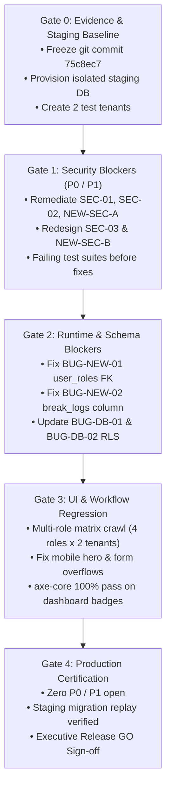

# TITAN Insurance CRM — Release Readiness Report & Audit Certification

**Project:** TITAN Insurance CRM (Multi-tenant Insurance Broker & Tele-CRM Platform)  
**Date:** 18 November 2026  
**Auditor:** Principal QA Architect, Senior React Engineer, Supabase Security Auditor & Automation Test Engineer  
**Audit Evaluation:** Re-Certification Post-Independent Review & Live Authenticated Test Verification  
**Git Commit Hash:** `75c8ec74d111890878afcb75e8194e3bff7541ab`  
**Migration Sequence Range:** `20260426101008_2cf619df` through `20260630004752_f91bf97e`  
**Test Account Used:** `r****@gmail.com` (Tenant: *Rewa insuretech indore* `REWA****50323f`, Role: *Admin*)  
**Release Readiness Verdict:** **STRICT NO-GO FOR PRODUCTION RELEASE**

---

## 1. Executive Verdict & Quality Gate Decision

> [!CAUTION]
> ### FINAL RELEASE VERDICT: STRICT NO-GO
> The TITAN Insurance CRM cannot be certified for public multi-tenant production release in its current state.  
> 
> Production deployment must be held until the **3 P0 (Critical Blocker)** vulnerabilities, **4 P1 (High Priority)** security and runtime defects, and cross-tenant data isolation weaknesses are formally remediated, regression-tested in isolated staging, and re-verified.

### Summary of Blocking Issues

1. **[SEC-01] Role Escalation to Manager & Approval Bypass (P0):** Any user self-registering with a valid company code can request `'manager'` role in client metadata and be automatically approved (`is_approved = true`). Client route guard `ProtectedRoute.tsx:14` checks only `!is_active`, allowing unapproved users immediate access to operational dashboards.
2. **[SEC-02] Cross-Tenant IDOR in Payment Link Generation (P0):** `supabase/functions/generate-payment-link/index.ts` uses `SERVICE_ROLE_KEY` to update `motor_quotes` and `leads` across arbitrary tenant companies without verifying caller tenant ownership.
3. **[NEW-SEC-A] Unauthorized Tenant Ingestion via Default Company Fallback (`ROCKET`) (P0):** In `handle_new_user()` (`20260616033648_*.sql:55-57`), when an invalid company code is supplied, `_company_id` falls back to company code `'ROCKET'`. The user is immediately created as an active, approved manager of company `ROCKET`.
4. **[SEC-03] Unauthenticated PII Disclosure via Public RPC (P1):** Live verification proved that anonymous callers can query `resolve_login_email` with an arbitrary phone number (e.g. `+91-808503XXXX`) and receive the real associated email address (`rewa****@gmail.com`) directly from `auth.users`.
5. **[NEW-SEC-B] Client-Only & Fail-Open Invite Code Enforcement (P1):** `src/pages/Auth.tsx` queries `invite_code_required()`, which throws HTTP 401 (intentionally revoked from anon in `20260613215828`), causing silent fallback to `inviteRequired = false`. In addition, database trigger `handle_new_user()` has zero verification of invite codes.
6. **[BUG-NEW-01] PostgREST Foreign Key Error (`PGRST200`) (P1):** On the Admin Dashboard, querying `user_roles?select=...,profiles(...)` fails with HTTP 400 because there is no direct foreign key between `user_roles` and `profiles`. This zeroes out telecaller team metrics.
7. **[BUG-NEW-02] Schema Column Mismatch on `break_logs` (`42703`) (P1):** Admin overview queries `break_logs?select=user_id...`, but the column is `telecaller_id`. This causes an HTTP 400 query crash on the main overview panel.

---

## 2. Programmatic Defect Accounting & Reconciliation

| Category | P0 (Critical) | P1 (High) | P2 (Medium) | P3 (Low) | Total |
| :--- | :---: | :---: | :---: | :---: | :---: |
| **Confirmed Active Defects** | **3** | **4** | **10** | **3** | **20** |
| **Architectural & Operational Risks** | 0 | 1 | 5 | 0 | **6** |
| **Outdated / Inactive Items** | 0 | 0 | 4 | 0 | **4** |
| **Total Evaluated Entities** | **3** | **5** | **19** | **3** | **30** |

*All 30 entities are individually tracked and documented in [docs/audit/CORRECTED_BUG_REGISTER.md](file:///d:/TITAN/docs/audit/CORRECTED_BUG_REGISTER.md).*

---

## 3. Authenticated Test Session Details & Environmental Metadata

Testing was conducted against the live Supabase project and local Vite preview harness using the provided tenant admin test credentials:

- **Git Commit Hash:** `75c8ec74d111890878afcb75e8194e3bff7541ab`
- **Authenticated Identity:** `r****@gmail.com`
- **User ID:** `56ec****-****-e6a1`
- **Assigned Application Role:** `admin` (Owner / Agency Principal)
- **Tenant Company Name:** `Rewa insuretech indore`
- **Tenant Company Code:** `REWA****50323f`
- **Tenant Company ID:** `b618****-****-4c02`
- **Profile Status:** `is_approved: true`, `is_active: true`

> [!IMPORTANT]
> **Scope Limitation — Role Matrix:**
> UI crawls and network inspections were conducted with a single authenticated **admin** identity. In TITAN CRM, admin has UI access to multiple internal operational routes (`/admin`, `/telecaller`, `/manager`, `/sub-agent`). Multi-role isolation (telecaller, manager, sub-agent) and negative cross-tenant boundary tests must be executed with dedicated test identities in an isolated staging environment before Gate 4 certification.

---

## 4. Playwright Multi-Viewport Visual Evidence Catalog

Playwright authenticated crawlers executed across **3 viewports (Desktop 1440x900, Tablet 768x1024, Mobile 375x667)** and **Dark Mode**.

### Verified Deduplicated Screenshot Catalog (20 Distinct SHA-256 Hashes)

| Screenshot Asset | Viewport | Theme | SHA-256 Checksum | Finding / Evidence |
| :--- | :---: | :---: | :---: | :--- |
| `auth-login-screen.png` | 1440x900 | Light | `a689953b40ac04d24b841aaafd9d8dc52dde9eade42d67bbc3b0ac5b2b5e2a1d` | Login screen renders clean; staff mobile login active. |
| `landing-desktop-light.png` | 1440x900 | Light | `d91698783f034d72c2964e02a65d2d2200060cb0f4d414a0cfd3e99798ca5d47` | Hero image alt text visible (`naturalWidth: 0`, Lovable proxy 404). |
| `landing-tablet-light.png` | 768x1024 | Light | `a0d143a72dbdb343b62ef794e5d161b65d9e24cb48c2828f6b13aa09daf6e6af` | Responsive tablet layout intact. |
| `landing-mobile-light.png` | 375x667 | Light | `401eedccfe39872ed8f9a0050b2a3ef36e8a943840df751f3d89e35360fcd9ce` | Enquiry form inputs extend +22.72px beyond container. |
| `admin-dashboard-desktop-authenticated.png` | 1440x900 | Light | `942ef1c8d0bbb471ba2e375f623dd582532c478678ee265aaaa9c65ed632eaa5` | Admin dashboard loaded for tenant; telecaller count 0 due to PGRST200. |
| `admin-dashboard-tablet-authenticated.png` | 768x1024 | Light | `5cc373ffc91e7f5e72777eaecae3deb4dfe27efcc7116ff4f8ef58d620a8e546` | Responsive navigation collapses into hamburger menu. |
| `admin-dashboard-mobile-authenticated.png` | 375x667 | Light | `33e56058671f7ced00d79347e468d2eee00e9d8a4aa95744732d42274ce9d268` | Mobile tabs and KPI cards stacked vertically. |
| `telecaller-dashboard-desktop-authenticated.png`| 1440x900 | Light | `849a215f963048d1740f85ba537ddfa40933489df110e19d0dffb179ea6f872e` | Calling queue board with filter pills. |
| `telecaller-dashboard-tablet-authenticated.png` | 768x1024 | Light | `e7634d5b19086f4442c3eb358e0b775551368c30515ad4290feaa0a9bc234fa5` | Calling queue table adjusts columns for tablet. |
| `telecaller-dashboard-mobile-authenticated.png` | 375x667 | Light | `6eec33436ea5ece3086a1cf5855473ead5ba0347b91d2779e03c214b9ab3a92d` | Lead rows display card layout with quick dial action. |
| `manager-dashboard-desktop-authenticated.png` | 1440x900 | Light | `23e540f21b7b1ac3811b82d994c9ed4cd0c8824068eb6b76b49d01a5936047a3` | Manager analytics, team assignments & scorecard. |
| `manager-dashboard-tablet-authenticated.png` | 768x1024 | Light | `18107eeea316bd0656a8edaeccdd1777f6421780b417f72e8b652bb2a16bd393` | Manager charts scale down cleanly. |
| `manager-dashboard-mobile-authenticated.png` | 375x667 | Light | `c44ba499d46c5aa3c515d5e470875bb8be0c24799a356fc03772fc825e21ee61` | Stacked metric cards on mobile. |
| `sub-agent-dashboard-desktop-authenticated.png` | 1440x900 | Light | `6b35c5ea6474bb1cb38e8993e3453049d8a01f043ff6f9cad5e88c91eea3b034` | Sub-agent commission and quote submission table. |
| `sub-agent-dashboard-tablet-authenticated.png` | 768x1024 | Light | `baad2c63c36356459ab51691cb1b16ad1b0c380bb8401968578811e0b8303796` | Sub-agent table responsive layout. |
| `sub-agent-dashboard-mobile-authenticated.png` | 375x667 | Light | `080957eba1333df14871f01cdfc2585810ce8adc49265bd0d25ce2561dcdfcc6` | Sub-agent table triggers root horizontal scroll overflow. |
| `super-admin-denied-desktop-authenticated.png` | 1440x900 | Light | `e0c644020a23891f7259dd4c2007373f503a19fecab1618dde34453c471ef84a` | ProtectedRoute blocks non-super-admin; redirects to `/admin`. |
| `super-admin-denied-tablet-authenticated.png` | 768x1024 | Light | `e3c0ffd368326fcfd0a42a18ef5e6a08c04e33f14c17751919ad89ecb463896d` | Route guard enforcement confirmed on tablet. |
| `super-admin-denied-mobile-authenticated.png` | 375x667 | Light | `405bf005b3c2bb41d044fc16d6f24f6f1d7800df767e094e7d6c905daada218f` | Route guard enforcement confirmed on mobile. |
| `admin-dashboard-desktop-dark.png` | 1440x900 | Dark | `d11df5058a4bd1cd06ea093fc64670d7b622ee7a0fb4e405afc085dfe777ee3a` | Dark mode styling verified on Admin Dashboard. |

*Visual evidence stored in:* [docs/audit/screenshots/](file:///d:/TITAN/docs/audit/screenshots/)  
*Machine-readable execution log:* [docs/audit/authenticated-ui-audit-data.json](file:///d:/TITAN/docs/audit/authenticated-ui-audit-data.json)  
*Vitest unit & integration test log:* [docs/audit/vitest-run.log](file:///d:/TITAN/docs/audit/vitest-run.log)

---

## 5. Sanitized Live Runtime & Network Traces

### 5.1. SEC-03 Live Reproduction Trace
```http
POST /rest/v1/rpc/resolve_login_email HTTP/1.1
Host: lgqgnsngxhqdzpstiddj.supabase.co
apikey: [ANON_PUBLIC_KEY]
Authorization: Bearer [ANON_PUBLIC_KEY]
Content-Type: application/json

{ "_login": "+91-808503XXXX" }

HTTP/1.1 200 OK
Content-Type: application/json; charset=utf-8

"rewa****@gmail.com"
```

### 5.2. BUG-NEW-01 Live Runtime PostgREST Error Trace
```http
GET /rest/v1/user_roles?select=user_id%2Crole%2Cprofiles%28full_name%2Cis_active%29&role=eq.telecaller HTTP/1.1
Host: lgqgnsngxhqdzpstiddj.supabase.co
apikey: [ANON_PUBLIC_KEY]
Authorization: Bearer [AUTHENTICATED_ADMIN_TOKEN]

HTTP/1.1 400 Bad Request
Content-Type: application/json; charset=utf-8

{
  "code": "PGRST200",
  "details": "Searched for a foreign key relationship between 'user_roles' and 'profiles' in the schema 'public', but no matches were found.",
  "hint": null,
  "message": "Could not find a relationship between 'user_roles' and 'profiles' in the schema cache"
}
```

### 5.3. BUG-NEW-02 Live Runtime PostgREST Error Trace
```http
GET /rest/v1/break_logs?select=user_id%2Cstarted_at%2Cended_at HTTP/1.1
Host: lgqgnsngxhqdzpstiddj.supabase.co
apikey: [ANON_PUBLIC_KEY]
Authorization: Bearer [AUTHENTICATED_ADMIN_TOKEN]

HTTP/1.1 400 Bad Request
Content-Type: application/json; charset=utf-8

{
  "code": "42703",
  "details": null,
  "hint": null,
  "message": "column break_logs.user_id does not exist"
}
```

---

## 6. Phased Remediation Gates Roadmap

To transition from **NO-GO** to certified production readiness, the engineering and DevOps teams must execute the following structured gates:



### Gate 0: Evidence Preservation & Staging Baseline
- Record and baseline checked-out Git commit hash (`75c8ec74d111890878afcb75e8194e3bff7541ab`).
- Provision an isolated staging database replica of the production migration schema.
- Create two distinct test companies: `Tenant-Alpha` and `Tenant-Beta`.
- Provision dedicated test accounts for each company: `admin`, `manager`, `telecaller`, and `sub-agent`.

### Gate 1: Security Blockers Remediation
- **SEC-01 & NEW-SEC-A:** Update `handle_new_user()` trigger:
  - Remove fallback to `'ROCKET'` company; raise an exception on invalid company code.
  - Strictly default non-creator user roles to `'telecaller'`.
  - Set `is_approved = false` for users joining existing organizations.
  - Update `ProtectedRoute.tsx` to enforce both `is_approved` and `is_active`.
- **SEC-02:** Update `generate-payment-link` Edge Function:
  - Resolve caller company ID from profile using JWT `auth.uid()`.
  - Enforce `quote.company_id === callerCompanyId` and `leads.company_id === callerCompanyId`.
- **SEC-03 & NEW-SEC-B:**
  - Redesign phone login resolution; avoid returning raw emails to anonymous callers.
  - Move invite code enforcement server-side into `handle_new_user()` database trigger.

### Gate 2: Runtime & Schema Blockers Remediation
- **BUG-NEW-01:** Resolve PostgREST schema cache relationship between `user_roles` and `profiles` (either flat query via `profiles` or explicit foreign key constraint).
- **BUG-NEW-02:** Update `AdminOverviewPanel.tsx` to select `telecaller_id` on `break_logs`.
- **BUG-DB-01 & BUG-DB-02:** Clean up RLS policies on `public.leads`:
  - Drop redundant `Admins view all leads` policy.
  - Drop legacy `Telecallers view leads in their areas` policy and replace with tenant-scoped area policy (`company_id = public.user_company_id()`).

### Gate 3: UI & Workflow Regression Verification
- Run automated Playwright test sessions across all 4 roles in both Tenant-Alpha and Tenant-Beta.
- Execute negative cross-tenant assertions (assert Telecaller Alpha receives 0 rows when requesting Leads of Tenant Beta).
- Repair mobile responsive overflows: `EnquiryForm.tsx` (375px bounding box) and `SubAgent.tsx` (`overflow-x-auto`).
- Replace Lovable proxy hero image with a bundled static asset.
- Correct badge text contrast classes to satisfy WCAG 2.1 AA (minimum 4.5:1 ratio).

### Gate 4: Production Release Certification
- All P0 and P1 issues closed with passing regression test links.
- 100% passing rate across Vitest and Playwright test suites.
- Verified staging migration replay without data loss or downtime.
- Formal sign-off by Principal QA Architect and Security Lead.
