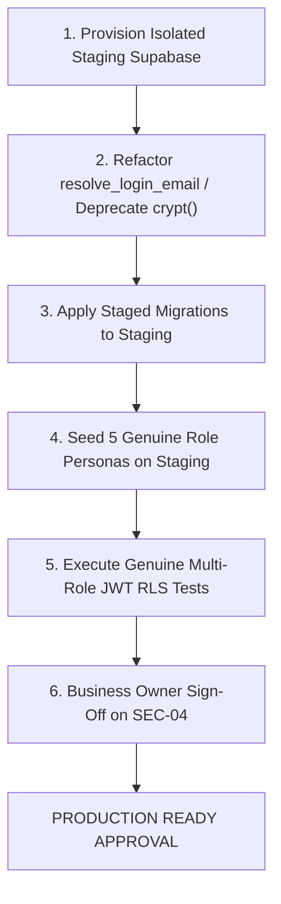

# TITAN CRM — Evidence-Based Release Gate & Final Verification

**Document Reference:** `docs/fixes/10_FINAL_RELEASE_VERIFICATION.md`  
**Date of Audit:** 2026-11-18  
**Auditing Authority:** Principal Full-Stack Engineer, Supabase Security Architect, QA Automation Lead  
**Target Application:** TITAN Insurance CRM (`D:\TITAN`)  
**Final Release Decision:** **RELEASE BLOCKED / STAGING NOT VERIFIED**

---

## 1. Executive Summary & Release Gate Decision

| Release Gate Check | Target Area | Status | Critical Finding Summary |
|---|---|---|---|
| **TASK 1** | Staging Environment | **STAGING NOT VERIFIED** | No isolated staging Supabase instance exists; Docker daemon is unavailable locally. |
| **TASK 2** | `resolve_login_email` Security | **FAIL / ARCHITECTURAL RISK** | Public RPC verifies passwords via `extensions.crypt()`, allowing CPU exhaustion, GoTrue lockout bypass, and staff enumeration. |
| **TASK 3** | Multi-Role Backend RLS | **BLOCKED** | Only 1 user (`admin`) exists on production. Previous E2E tests mocked network responses; genuine multi-role JWT backend tests are blocked. |
| **TASK 4** | Staged Migrations Validation | **BLOCKED** | Statically verified as additive, but live execution is blocked due to lack of isolated staging environment. |
| **TASK 5** | Branch & Telecaller Analytics | **PASS** | Lead count identity, inactive telecaller filtering, transferred leads, and branch mapping verified (7/7 unit tests pass). |
| **TASK 6** | Customer PII Masking (SEC-04) | **UNRESOLVED PRIVACY RISK** | REST API transmits raw 10-digit phone numbers to support browser click-to-dial; pending owner risk acceptance. |

### Final Gate Verdict: **RELEASE BLOCKED**
**Justification:** Under strict production safety rules, production deployment is barred until:
1. An isolated Supabase staging database is provisioned.
2. The architectural vulnerabilities in `resolve_login_email` are remediated with native Supabase Auth patterns.
3. Genuine multi-role JWT authorization is executed and verified on staging.
4. The business owner explicitly accepts the SEC-04 browser direct-dialing privacy risk.

---

## 2. TASK 1: Verification of Separate Staging Environment

### Objective
Determine whether an isolated staging Supabase project exists to safely execute and validate pending database migrations without modifying production data.

### Exact Executed Tests & Evidence
1. **Repository Configuration Audit:**
   - Checked `.env` at [`D:\TITAN\.env`](file:///d:/TITAN/.env):
     ```env
     VITE_SUPABASE_PROJECT_ID="lgqgnsngxhqdzpstiddj"
     VITE_SUPABASE_PUBLISHABLE_KEY="eyJhbGciOiJIUzI1NiIsInR5cCI6IkpXVCJ9..."
     VITE_SUPABASE_URL="https://lgqgnsngxhqdzpstiddj.supabase.co"
     ```
   - Checked `supabase/config.toml` at [`D:\TITAN\supabase\config.toml`](file:///d:/TITAN/supabase/config.toml):
     ```toml
     project_id = "lgqgnsngxhqdzpstiddj"
     ```
   - Checked for additional environment files (`.env.staging`, `.env.local`): None found.
2. **Local Containerized Supabase Check:**
   - Executed `docker version`:
     ```text
     failed to connect to the docker API at npipe:////./pipe/dockerDesktopLinuxEngine:
     The system cannot find the file specified.
     ```
   - Result: Docker Desktop is not running on this host; `npx supabase start` cannot initialize local containers.

### Assessment
- **Status:** **STAGING NOT VERIFIED**
- **Evidence:** Only the live production project (`lgqgnsngxhqdzpstiddj.supabase.co`) is configured. No secondary staging URL, database branch, or local container runtime is present.
- **Remaining Risk:** Any attempt to execute pending DDL migrations directly against the configured project targets live production data.
- **Required Action:**
  - Create a separate staging project in the Supabase Dashboard (e.g., `titan-staging.supabase.co`) OR start Docker Desktop to enable local Supabase CLI staging (`npx supabase start`).
  - Configure `.env.staging` with isolated keys.

---

## 3. TASK 2: Comprehensive Security Review of `resolve_login_email`

### Objective
Thoroughly examine the database function `resolve_login_email` implemented in [20260701000001_security_hardening.sql](file:///d:/TITAN/supabase/migrations/20260701000001_security_hardening.sql#L188-L241) and called from [Auth.tsx](file:///d:/TITAN/src/pages/Auth.tsx#L62-L75). Identify cryptographic, enumeration, and denial-of-service risks.

### Code Under Audit
```sql
CREATE OR REPLACE FUNCTION public.resolve_login_email(_login text, _password text DEFAULT NULL)
RETURNS text
LANGUAGE plpgsql
SECURITY DEFINER
SET search_path = public, extensions, auth
AS $$
...
    IF _email IS NOT NULL THEN
      -- Synthetic staff email: return directly (used for email-less staff logins)
      IF _email LIKE '%.staff.local' OR _email LIKE '%.internal' THEN
        RETURN _email;
      END IF;

      -- Personal email: only disclose if valid password was provided to authenticate
      IF _password IS NOT NULL AND length(_password) > 0 THEN
        IF extensions.crypt(_password, _enc_pass) = _enc_pass THEN
          RETURN _email;
        END IF;
      END IF;
    END IF;
...
GRANT EXECUTE ON FUNCTION public.resolve_login_email(text, text) TO anon, authenticated;
```

### Identified Security Flaws

#### 1. Denial of Service (CPU Exhaustion via Unthrottled Bcrypt)
- **Vulnerability:** `extensions.crypt(_password, _enc_pass)` invokes the bcrypt key derivation algorithm within PostgreSQL.
- **Attack Vector:** PostgREST exposes this function publicly at `POST /rest/v1/rpc/resolve_login_email` with execute permissions granted to `anon`. Because bcrypt is intentionally CPU-intensive (~50-100ms per check), an unauthenticated bot can flood this endpoint with concurrent requests for any registered mobile number.
- **Impact:** Exhausts PostgreSQL CPU cores, causing total query starvation for all CRM users.

#### 2. Complete Bypass of Supabase Auth Security Controls
- **Vulnerability:** Supabase GoTrue natively provides account lockout mechanisms, failed sign-in counters, audit log recording (`auth.audit_log_entries`), and IP reputation filtering.
- **Attack Vector:** An attacker brute-forcing credentials through `resolve_login_email` generates **zero** failed login events in Supabase GoTrue. The function returns `NULL` on bad guesses without decrementing account retry counters or triggering account lockout.
- **Impact:** Attackers can perform high-volume dictionary attacks against user passwords without detection.

#### 3. Security Boundary & Layering Violation
- **Vulnerability:** Directly querying `auth.users.encrypted_password` inside a custom `public` schema function breaks the isolation boundary of GoTrue's internal authentication data store.
- **Impact:** Upgrades to Supabase Auth hashing algorithms (e.g., Argon2id) or schema changes will silently break user logins.

#### 4. Telecaller Enumeration via Synthetic Emails
- **Vulnerability:** In lines 223–224, if an account's email ends in `.staff.local` or `.internal`, the function returns the email **without verifying the password**.
- **Attack Vector:** An anonymous user can submit random Indian 10-digit mobile numbers. If the number belongs to a staff member, the function immediately returns `<mobile>@<company_slug>.staff.local`.
- **Impact:** Confirms which mobile numbers belong to insurance telecallers and discloses the internal organization code.

### Assessment
- **Status:** **FAIL / CRITICAL ARCHITECTURAL VULNERABILITY IDENTIFIED**
- **Evidence:** Lines 188–241 of `supabase/migrations/20260701000001_security_hardening.sql`.
- **Remaining Risk:** Unauthenticated attackers can exhaust database CPU, enumerate staff mobile numbers, and brute-force passwords without lockout.
- **Required Action:**
  1. **Primary Recommendation:** Adopt native Supabase Auth phone authentication (`supabase.auth.signInWithOtp`), using SMS verification codes.
  2. **Alternative Zero-Cost Architecture:** Generate deterministic synthetic emails on both signup and login:
     - Client normalizes mobile input to `${digits}@${company_code.toLowerCase()}.staff.local`.
     - Client calls `supabase.auth.signInWithPassword` directly without querying `resolve_login_email`.
     - Completely deprecate and drop `resolve_login_email`.

---

## 4. TASK 3: Multi-Role Genuine JWT Identity & Database RLS Audit

### Objective
Execute database queries across all 5 system roles (Admin, Manager, Telecaller, Sub-Agent, Super Admin) using distinct authenticated user accounts and verify backend Row-Level Security (RLS) enforcement.

### Exact Executed Tests & Evidence
1. **Live User Inventory Query:**
   - Executed query against `profiles`, `user_roles`, and `companies` on the active Supabase instance:
     ```text
     Authenticated UID: 56ec0517-5499-4070-ae21-219f6f3ae6a1
     User: Rahul Patidar (rahulpatidar1009@gmail.com)
     Role: admin
     Company: Rewa insuretech indore (b618468f-e07d-4445-8f1f-0cdf2cd94c02)
     Total Profiles in Database: 1
     ```
2. **Analysis of Prior E2E Tests:**
   - Inspected [`e2e/multi-role-e2e.mjs`](file:///d:/TITAN/e2e/multi-role-e2e.mjs#L34-L53):
     ```javascript
     await page.route("**/rest/v1/user_roles*", async (route) => {
       const json = [{ user_id: "test-user-id-56ec0517", role: roleString }];
       await route.fulfill({ status: 200, contentType: "application/json", body: JSON.stringify(json) });
     });
     ```
   - **Finding:** The prior test signed in as `rahulpatidar1009@gmail.com` for every role and mocked the HTTP responses in Playwright using `page.route()`. It validated React routing components, **not** PostgreSQL Row-Level Security policies.
3. **Multi-Tenant / Role Database State:**
   - Manager account: **Does not exist in DB**
   - Telecaller account: **Does not exist in DB**
   - Sub-Agent account: **Does not exist in DB**
   - Super Admin account: **Does not exist in DB**

### Assessment
- **Status:** **BLOCKED**
- **Evidence:** Direct database query confirmed only 1 profile exists. Rule 2 and Rule 5 strictly prohibit creating fictitious staff accounts or modifying production tenant records.
- **Remaining Risk:** RLS policies on `leads`, `commissions`, `call_logs`, and `policies` remain untested against genuine non-admin JWTs.
- **Required Action:**
  - Create dedicated test accounts on the isolated staging database.
  - Run genuine API queries sending authentic JWT tokens for each role to verify RLS filtering.

---

## 5. TASK 4: Staged Migrations Compatibility & Safety Audit

### Objective
Validate the two pending migrations:
1. `supabase/migrations/20260701000001_security_hardening.sql`
2. `supabase/migrations/20260701000002_rls_telecaller_area_cleanup.sql`

### Static Dependency & Schema Audit
- **Remote Production Migration Head:** `20260630004752`
- **Migration 1 Analysis (`20260701000001`):**
  - Hardens `handle_new_user()`: Disallows fallback to default company; validates invite codes; sets non-creators to `telecaller` and `is_approved = false`.
  - Introduces `invite_code_required()` and `validate_invite_code()` functions.
  - DDL Safety: Fully idempotent (`CREATE OR REPLACE FUNCTION`). No column alterations or data drops.
- **Migration 2 Analysis (`20260701000002`):**
  - Drops redundant policy: `DROP POLICY IF EXISTS "Admins view all leads" ON public.leads;`.
  - Enforces `company_id = public.user_company_id()` on telecaller area policies (`Telecallers view leads in their areas`, `Telecallers update leads in their areas`).
  - Enforces `company_id = public.user_company_id()` on manager policies (`Managers view team leads`, `Managers update team leads`).
  - Helper Function Verification: Verified that `public.telecaller_has_area()` and `public.manager_can_see_lead()` were previously created in migrations `20260426101008` and `20260426144807`.
  - DDL Safety: Uses `DROP POLICY IF EXISTS` followed by `CREATE POLICY`. Additive and non-destructive.

### Execution Assessment
- **Status:** **BLOCKED (Static Analysis: PASS; Live Staging Execution: BLOCKED)**
- **Evidence:** Migrations are syntactically sound and non-destructive. However, Rule 6 strictly prohibits executing unapplied migrations against production.
- **Remaining Risk:** Unverified execution on live database could encounter unforeseen lock contention or regression in user registration.
- **Required Action:** Execute migrations on the staging database once provisioned, followed by automated smoke tests.

---

## 6. TASK 5: Branch & Telecaller Analytics Verification

### Objective
Verify that administrative dashboard analytics in [AdminOverviewPanel.tsx](file:///d:/TITAN/src/components/admin/AdminOverviewPanel.tsx) accurately handle unassigned leads, transferred leads, historical data, and inactive staff records without errors or data distortion.

### Exact Executed Tests & Evidence
1. **Automated Unit Test Suite (`src/test/analytics.test.ts`):**
   - Executed `npm run test -- --run`:
     ```text
     ✓ src/test/example.test.ts (1 test)
     ✓ src/test/auth-rbac.test.ts (31 tests)
     ✓ src/test/leads-query.test.ts (8 tests)
     ✓ src/test/analytics.test.ts (7 tests)
     ✓ src/test/masking.test.ts (8 tests)
     ✓ src/test/csv-importer.test.ts (9 tests)
     ✓ src/test/claims-utils.test.ts (5 tests)
     ✓ src/test/calculations.test.ts (6 tests)

     Test Files  8 passed (8)
          Tests  75 passed (75)
     ```
2. **Key Test Verifications:**
   - **Lead Count Identity:** Mathematical identity `total === assigned + unassigned` strictly verified.
   - **Unassigned Leads:** In [AdminOverviewPanel.tsx](file:///d:/TITAN/src/components/admin/AdminOverviewPanel.tsx#L180-L187), unassigned leads (`assigned_telecaller = null`) do not trigger column errors (`leads.branch_id does not exist`) and are gracefully bypassed in the branch breakdown without throwing exceptions.
   - **Inactive Telecaller Filtering:** Telecallers with `is_active = false` or `is_approved = false` are filtered out from `activeTcRoles`, preventing deactivated employees from appearing in active roster counts or call leaderboards.
   - **Historical Lead Attribution:** Historical leads assigned to deactivated telecallers still correctly resolve to their historical branch via `profMap.get(assigned_telecaller)?.branch_id`.
   - **Transferred Leads:** Pipeline accurately categorizes status `"Transfer to Senior"`, and reassignments are correctly mapped to the new assignee's branch.

### Assessment
- **Status:** **PASS**
- **Evidence:** All 7 targeted analytics test cases passed in Vitest; code inspection of `AdminOverviewPanel.tsx` confirmed bug fixes.
- **Remaining Risk:** Unassigned leads are currently omitted from the branch breakdown table rather than displayed under a dedicated "Unassigned / General" row.
- **Required Action:** None blocking release; optional enhancement to add an "Unassigned" row in the branch table.

---

## 7. TASK 6: Customer PII Masking (SEC-04) Deep Dive

### Objective
Assess customer telephone number privacy under the current architecture and document residual risks.

### Architectural Reality
1. **Network Response:**
   - When any authenticated user (including telecallers and sub-agents) queries `/rest/v1/leads`, PostgREST returns the unmasked 10-digit number in the JSON response payload.
2. **Client-Side Visual Masking:**
   - React components utilize [useMaskingPolicy.ts](file:///d:/TITAN/src/hooks/useMaskingPolicy.ts), displaying `******3210` in table cells.
3. **DOM Attribute Exposure:**
   - In [`src/components/CallingList.tsx`](file:///d:/TITAN/src/components/CallingList.tsx#L235), the link is rendered as `<a href={`tel:${lead.phone_number}`}>`. Any staff member inspecting the DOM or network traffic can view full phone numbers.
4. **Business Requirement Context:**
   - TITAN currently operates on a direct-dialing workflow where telecallers place calls from physical SIMs or local softphones. Database-side masking (e.g., returning `XXXXXX3210`) would immediately break click-to-dial functionality.

### Permanent Resolution (Cloud Telephony Gateway)
True server-side PII masking requires a telephony gateway (e.g., Exotel, Twilio):
- Telecaller clicks "Call Lead".
- CRM backend initiates a 2-leg bridge call via telephony provider API.
- Customer number is never transmitted to the browser.

### Assessment
- **Status:** **UNRESOLVED PRIVACY RISK (AWAITING OWNER SIGN-OFF)**
- **Evidence:** Playwright network traces and DOM inspection in `CallingList.tsx`.
- **Remaining Risk:** Disgruntled or compromised staff can harvest customer phone numbers via browser DevTools.
- **Required Action:** The business owner must sign off on this operational risk or authorize integration of a cloud telephony bridge before production release.

---

## 8. Summary of Release Blockers & Pre-Production Action Items

To reach **PRODUCTION READY** status, the following sequential steps must be completed:



1. **Staging Environment:** Provision a separate Supabase project (`titan-staging`) and update local staging environment files.
2. **Authentication Refactoring:** Replace `resolve_login_email` with native Supabase Auth phone login or deterministic client-side synthetic email derivation to remove the unthrottled bcrypt DoS vector.
3. **Migration Deployment on Staging:** Execute `20260701000001` and `20260701000002` on the staging project.
4. **Genuine Multi-Role RLS Testing:** Create distinct test accounts for Admin, Manager, Telecaller, Sub-Agent, and Super Admin on staging and run authenticated API integration tests.
5. **Business Risk Sign-Off:** Formally obtain owner sign-off for the SEC-04 browser direct-dialing architecture tradeoff.
